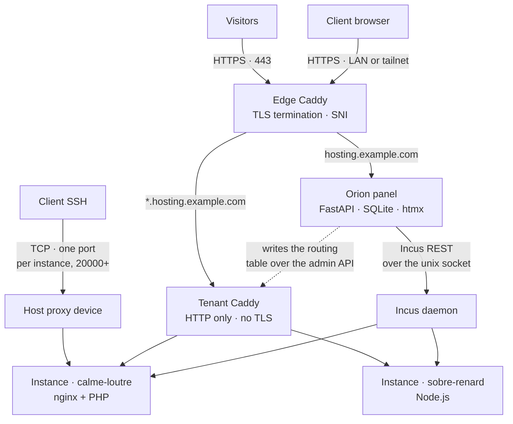

<div align="center">

# Orion

**A lightweight, self-hosted VPS hosting panel.**
One host, many small servers — real quotas, snapshots and SSH.

[](LICENSE)
[](https://www.python.org/)
[](https://linuxcontainers.org/incus/)
[](https://caddyserver.com/)
[](#status)

</div>

---

Orion turns a single machine into a small hosting provider. It detects the
hardware it is deployed on, works out how many *virtual light servers* that
machine can genuinely carry, and provisions them as
[Incus](https://linuxcontainers.org/incus/) **system containers** — with real
CPU/RAM/disk quotas, snapshots and SSH access, the way a classic web host works
but at the marginal cost of one container.

Renting a VPS is expensive for a small site. If you already run a machine, that
container costs you almost nothing. Orion is the panel for that.

## What it does

| | |
|---|---|
| **Host detection** | Reads the real CPU, RAM and free disk, subtracts what you reserve for the OS, and refuses to sell more than the machine can carry. |
| **Real quotas** | Each instance is pinned to its own CPU cores and capped in RAM and disk. A 1 vCPU plan gets one core — not a share of four. |
| **Snapshots** | Timestamped, per instance, restorable. Take one before you touch anything. |
| **Web console** | A real PTY over WebSocket, rendered with xterm.js: Ctrl-C, resize and full-screen programs all work. |
| **Per-instance identity** | Every machine gets its own SSH account, its own machine id, and reports the *plan* it was rented as — not the hardware underneath it. |
| **Service publishing** | Orion finds what is listening inside the instance, and routes it to a subdomain in one click. |
| **Tenant isolation** | Instances reach the internet and DNS, and nothing else — not the LAN, not the tailnet, not each other. |
| **Two dashboards** | An admin view (capacity, clients, instances, plans, invoices, activity) and a client view (provision, manage, snapshot, console, invoices). |

## Architecture



The panel is deliberately **server-rendered** — FastAPI, Jinja2 and htmx, one
stylesheet, no build step — so deploying it is a `git pull` and a
`docker compose up --build`. The tenant router is a second, separate Caddy that
Orion configures atomically over its admin API: a client publishing a site never
touches the edge that terminates TLS for everything else.

More detail: [`docs/ARCHITECTURE.md`](docs/ARCHITECTURE.md).

## Requirements

- **A host running Debian 12 (bookworm), x86-64.** The setup script pins the
  `amd64` Incus repository; on arm64, install Incus yourself first and skip to
  step 2.
- **Root on that host**, and at least ~80 GB of free disk.
- **Docker Engine with the Compose plugin**, for the panel itself.
- **A domain name**, plus a DNS provider Caddy can solve a DNS-01 challenge
  with (Cloudflare in the reference setup). Nothing needs to reach the host from
  the internet for certificates to be issued.
- An **edge Caddy** on 443 — the one you already have is fine, or start one with
  `deploy/caddy/`.

## Installation

### 1. Prepare the host

```bash
git clone git@github.com:paulschk/orion.git
cd orion

sudo deploy/incus-host-setup.sh
```

The script is idempotent and safe to re-run. It:

1. installs **Incus 7** from the [Zabbly](https://pkgs.zabbly.com/) repository;
2. creates the storage pool `orion` — a btrfs filesystem on a sparse loop file,
   so per-instance quotas and snapshots work with no extra kernel module and no
   reboot;
3. creates the `incusbr0` bridge (`10.42.0.1/24`, NAT, managed DNS);
4. applies a default profile that disables IPv6 inside containers — a bridge
   with no IPv6 route otherwise makes `apt` hang on Debian images;
5. fixes the **Incus/Docker forwarding conflict**, where Docker's `FORWARD`
   policy silently drops every packet leaving the Incus bridge, and persists the
   fix as a systemd unit.

Overridable with `ORION_POOL`, `ORION_POOL_SIZE`, `ORION_POOL_FILE`,
`ORION_BRIDGE` and `ORION_BRIDGE_CIDR`.

### 2. Create the network the panel joins

The panel and the edge Caddy share a Docker network so they can reach each other
by name:

```bash
docker network create gpi
```

(Name and existence are declared in `docker/docker-compose.yaml`.)

### 3. Configure the panel

```bash
cp docker/.env.example docker/.env
$EDITOR docker/.env
```

At minimum, set these five:

| Variable | Why |
|---|---|
| `ORION_SECRET_KEY` | Session signing. Generate one: `python3 -c "import secrets; print(secrets.token_urlsafe(48))"` |
| `ORION_ADMIN_EMAIL` | The first admin account, created on first boot. |
| `ORION_ADMIN_PASSWORD` | Change it after the first login. |
| `ORION_DOMAIN` / `ORION_BASE_URL` | The panel's own hostname. |
| `ORION_INGRESS_IP` | Your host's public address, shown to clients who want to point their own domain at it. |

Everything else has a working default; the full list is in
[Configuration](#configuration).

### 4. Start it

```bash
./deploy/deploy.sh
```

It checks `.env`, creates `docker/data` and `docker/caddy`, seeds a valid
bootstrap config for the tenant router, then builds and starts both containers.
The panel listens on the internal network only — it is never published directly.

### 5. Put it behind TLS

Append the block from
[`deploy/caddy/hosting.node29.fr.caddy`](deploy/caddy/hosting.node29.fr.caddy)
to your edge `Caddyfile`, adjusting the hostname, then:

```bash
cp -a /srv/caddy/Caddyfile /srv/caddy/Caddyfile.bak-$(date +%s)      # always keep one
docker exec caddy caddy validate --config /etc/caddy/Caddyfile --adapter caddyfile
docker exec caddy caddy reload   --config /etc/caddy/Caddyfile --adapter caddyfile
```

The reference block sends the apex to the panel and every subdomain to the
tenant router, and **restricts both to the LAN and the tailnet** — delete the
two `@external` lines to expose the panel publicly, and read
[Security](#security-posture) first.

### 6. Point DNS at the host

Two records, both **DNS-only** (grey cloud) if you use Cloudflare, because the
edge answers the ACME DNS-01 challenge itself:

| Type | Name | Value |
|---|---|---|
| `A` | `hosting.example.com` | your host's public IPv4 |
| `A` | `*.hosting.example.com` | your host's public IPv4 |

The wildcard is what gives every tenant subdomain a certificate, and it is why
a client can publish a site without you doing anything.

### 7. Verify, then log in

```bash
curl -sS https://hosting.example.com/healthz
# {"status":"ok","incus":true,"incus_detail":"7.6","host":"Lilith","brand":"node29"}
open https://hosting.example.com                  # the account from step 3
```

For a real end-to-end check — it provisions a throwaway LEMP instance, exercises
its limits, its site, its SSH, its quota and its snapshots, then destroys it
cleanly:

```bash
bash scripts/e2e-check.sh        # REMOTE=, LILITH=, PANEL_HOST= to override
```

## Honest disk quotas (recommended)

The btrfs pool from step 1 enforces the quota, but **`df` inside the instance
reports the whole pool** — btrfs qgroups are invisible to `statvfs`, so a client
on a 10 GB plan sees 80 GB and believes it. An LVM thin pool reports the real
size. It costs four commands and one unit file:

```bash
# A sparse 40 GB backing file, attached as a loop device.
truncate -s 40G /var/lib/incus/disks/orion-lvm.img
losetup --find --show /var/lib/incus/disks/orion-lvm.img

# A volume group on it, then a pool Incus owns.
pvcreate "$(losetup -j /var/lib/incus/disks/orion-lvm.img | cut -d: -f1)"
vgcreate orionvg "$(losetup -j /var/lib/incus/disks/orion-lvm.img | cut -d: -f1)"
incus storage create orion-lvm lvm source=orionvg
incus storage set orion-lvm volume.size=10GiB        # default instance disk
```

Let Incus create the thin pool itself — `source=orionvg/IncusThinPool` is
rejected with *Invalid volume group name*. Then persist the loop device, because
Incus manages the loop for its own btrfs driver but not for a hand-made one:

```bash
cat > /etc/systemd/system/orion-lvm-loop.service <<'UNIT'
[Unit]
Description=Attach the loop device backing the Orion LVM storage pool
DefaultDependencies=no
After=systemd-udev-settle.service
Wants=systemd-udev-settle.service
Before=lvm2-monitor.service incus.service

[Service]
Type=oneshot
RemainAfterExit=yes
ExecStart=/bin/bash -c 'losetup -j /var/lib/incus/disks/orion-lvm.img | grep -q loop || losetup --find --show /var/lib/incus/disks/orion-lvm.img'
ExecStartPost=/sbin/vgchange -ay orionvg
ExecStop=/sbin/vgchange -an orionvg

[Install]
WantedBy=multi-user.target
UNIT
systemctl daemon-reload && systemctl enable --now orion-lvm-loop.service
```

Finally point the default profile's root device at the new pool. Instances
created before the switch keep their own device config, so this is safe on a
live host:

```bash
incus profile device set default root pool=orion-lvm
```

## Configuration

`docker/.env` is read by the panel container. The variables that matter:

| Variable | Default | Purpose |
|---|---|---|
| `ORION_BRAND` / `ORION_APP_NAME` | `node29` / `Orion` | Names shown in the panel and its pages. |
| `ORION_DOMAIN` / `ORION_BASE_URL` | — | The panel's hostname and its public URL. |
| `ORION_SECRET_KEY` | *(required)* | Session signing key. |
| `ORION_ADMIN_EMAIL` / `ORION_ADMIN_PASSWORD` | — | First admin, created on first boot if none exists. |
| `ORION_DATA_DIR` | `/data` | SQLite database and provisioning logs. |
| `ORION_INCUS_POOL` / `ORION_INCUS_NETWORK` | `orion` / `incusbr0` | Where instances live. |
| `ORION_INCUS_IMAGE` | `images:debian/12` | Base image for every template. |
| `ORION_INCUS_SOCKET` | `/var/lib/incus/unix.socket` | The daemon socket — the panel needs the socket, never privileges. |
| `ORION_SSH_HOST` / `ORION_SSH_PORT_MIN` / `ORION_SSH_PORT_MAX` | — / `20000` / `20999` | Where clients SSH, and the port range handed out per instance. |
| `ORION_CADDY_ADMIN` / `ORION_CADDY_CONFIG` | `http://orion-caddy:2019` / `/caddy/caddy.json` | The tenant router and the table Orion writes to it. |
| `ORION_TENANT_LISTEN` | `:8080` | Where the tenant router listens behind the edge. |
| `ORION_INGRESS_IP` | — | Public address shown to clients for their own domains. |
| `ORION_RESERVE_VCPU` / `_RAM_MB` / `_DISK_GB` | `1` / `1536` / `10` | Held back from the host for the OS and the panel. Set to `0` to sell everything. |
| `ORION_CPU_TOTAL` / `_RAM_TOTAL_MB` / `_DISK_TOTAL_GB` | *(auto)* | Hard overrides for host detection. |
| `ORION_BILLING_MODE` / `ORION_CURRENCY` | `mock` / `EUR` | Billing is mocked; see [`docs/BILLING.md`](docs/BILLING.md). |

> **A note on capacity.** `ORION_RESERVE_VCPU=1` on a 4-core host leaves 3 vCPU
> to sell, and three 1 vCPU instances fill it. That is the honest arithmetic,
> not a bug — lower the reserve (and accept that the OS competes with tenants),
> or add a second host.

## Security posture

Stated plainly, because a hosting panel is a high-value target:

- **Tenant isolation is enforced** by an nftables table at a priority ahead of
  Incus's and Docker's own chains: instances reach the internet and DNS, and
  nothing else — not the LAN, not the tailnet, not each other, not the host's
  own services.
- **The panel is not exposed by default.** The reference Caddy block answers
  `403` to anything outside the LAN and the tailnet.
- **Login has no rate limiting yet.** Do not expose the panel to the internet
  before that is added.
- **Stored initial instance passwords are plaintext**, by design, so the panel
  can show them once. Clients are expected to switch to their key.
- **Isolation is a shared kernel**, as with any system container. Docker inside
  an instance requires `security.nesting`, which widens the surface.
- The full list, including what is deliberately accepted, is in
  [`docs/SECURITY.md`](docs/SECURITY.md).

## Status

A **proof of concept, deployed and working** — it runs real instances with real
limits on a real host. What is not finished is stated in the docs rather than
implied away: billing is mocked, the login is unthrottled, and a client cannot
yet reach the panel from an untrusted network. A multi-node master/agent model
is planned; today Orion manages exactly one host, thoroughly.

## Documentation

| Document | Contents |
|---|---|
| [`docs/ARCHITECTURE.md`](docs/ARCHITECTURE.md) | How the pieces fit, and why containers rather than VMs. |
| [`docs/DEPLOYMENT.md`](docs/DEPLOYMENT.md) | The full runbook, with troubleshooting. |
| [`docs/SECURITY.md`](docs/SECURITY.md) | Threat model, what is enforced, what is accepted. |
| [`docs/BILLING.md`](docs/BILLING.md) | The mocked billing, and the single function to replace for Stripe. |

## Licence

MIT — see [`LICENSE`](LICENSE).

Built on [Incus](https://linuxcontainers.org/incus/),
[Caddy](https://caddyserver.com/), [FastAPI](https://fastapi.tiangolo.com/),
[htmx](https://htmx.org/) and [xterm.js](https://xtermjs.org/).
